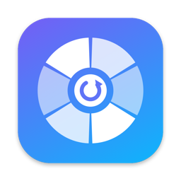
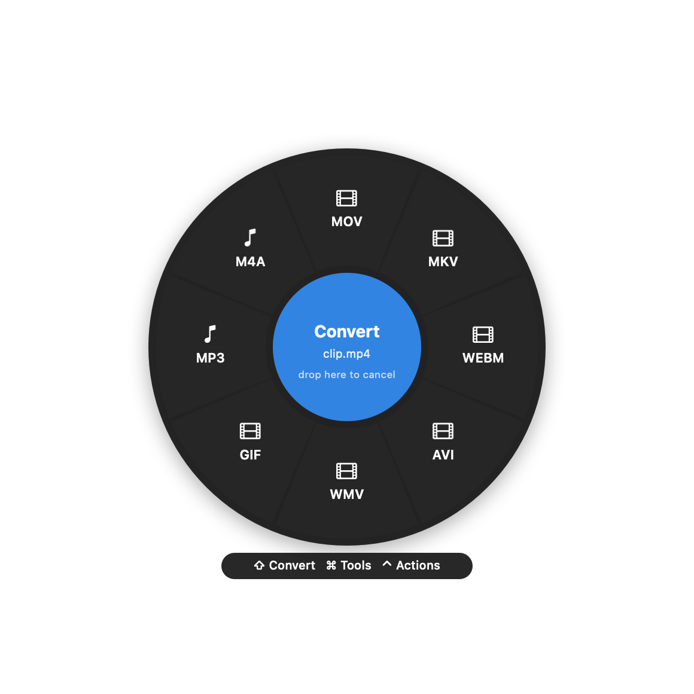
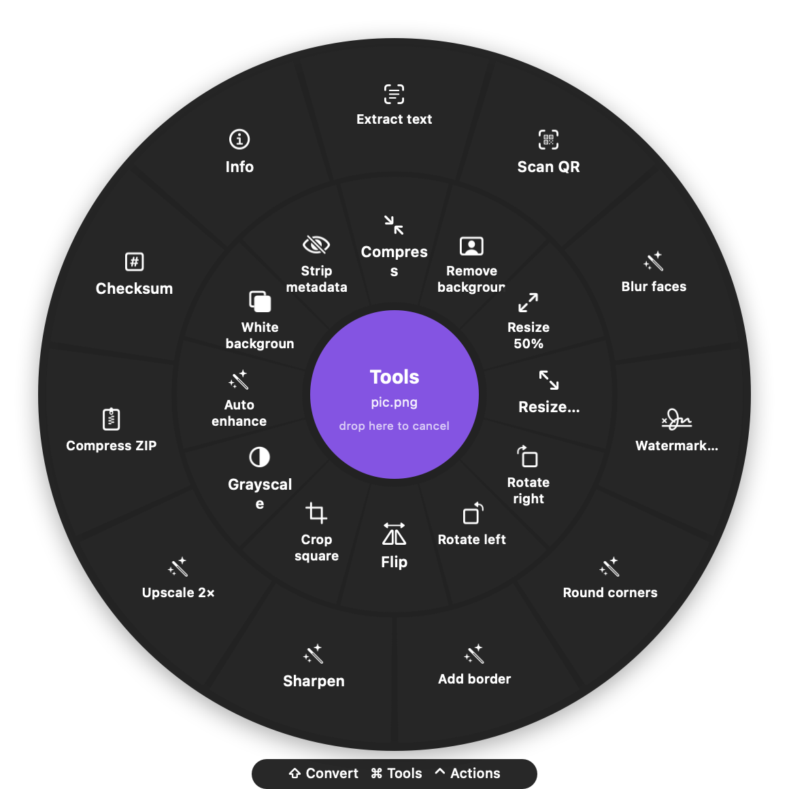
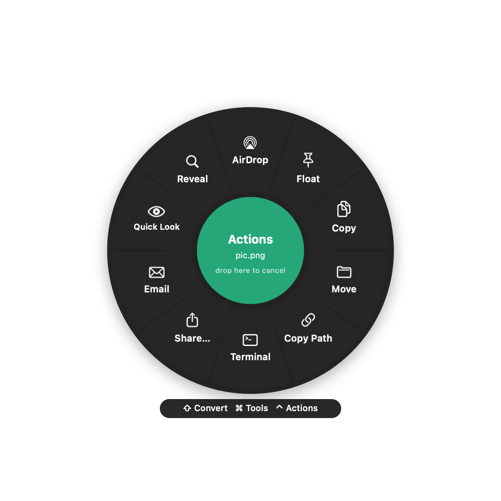

<p align="center"></p>

<h1 align="center">Shapeshift</h1>

<p align="center"><b>A free, open-source, offline file converter for macOS.</b><br>
Drag any file, tap a key, drop it on a wedge. Done.</p>

<p align="center">
  <a href="https://github.com/AkshayKumarBolusani/shapeshift/releases/latest"><b>⬇ Download for Mac</b></a> ·
  macOS 13+ · Apple silicon & Intel · MIT licensed
</p>

<p align="center">
  
  
  
</p>

## How it works

Shapeshift lives in your menu bar. Start dragging any file, from Finder, the Desktop or anywhere else, then **tap a key**:

| Tap while dragging | Wheel | What you get |
|---|---|---|
| **⇧ Shift** | Convert | Every format that file can become |
| **⌘ Command** | Tools | Compress, trim, merge, OCR, transcribe, remove background… |
| **⌃ Control** | Actions | AirDrop, Float, Copy, Move, Copy Path, Terminal, Share, Email, Quick Look, Reveal |

- You can let go of the key and the wheel stays open. Drop on a wedge to run it, or drop on the center to cancel.
- Tap another key mid-drag to switch wheels.
- Results are saved **as a new copy next to the original**. Originals are never touched.
- **Keyboard:** select files in Finder and press **⌃⌥Space**. Use the arrows to choose, ↩ to run, Tab to switch wheel, 1–9 to pick directly and Esc to cancel.
- All keys and the save location can be changed in **Settings**.

## The Shapeshift window

Click the Shapeshift app icon (or **Open Shapeshift…** in the menu bar) to open its window:

- **Wheel Features:** turn any wedge on or off and drag to reorder, per file type and per wheel, with a live preview. Reset one wheel or everything.
- **General:** wheel keys, the ⌃⌥Space shortcut, where results are saved, pop-ups, the menu bar icon and open at login.
- **Quality:** image quality and PDF → image resolution.
- **Engines:** see what's installed and install ffmpeg, WebP or LibreOffice with one click.
- **History:** every file you've made, with Open and Show in Finder.
- **How to Use** and **About**.

Everything happens **on your Mac**. There are no uploads, no account, no tracking and no internet needed.

## Install

1. Download **Shapeshift.dmg** from [Releases](https://github.com/AkshayKumarBolusani/shapeshift/releases/latest), open it, and drag Shapeshift into **Applications**.
2. On first launch macOS will say it can't verify the developer, because the app isn't sold through the App Store.
   Open **System Settings → Privacy & Security**, scroll down and click **Open Anyway**. Or run:
   ```bash
   xattr -dr com.apple.quarantine /Applications/Shapeshift.app
   ```
3. **For audio and video**, install the free ffmpeg engine. Shapeshift offers to do it for you on first launch:
   ```bash
   brew install ffmpeg webp
   ```
   (No Homebrew? Get it at [brew.sh](https://brew.sh).) Images, PDFs, documents, spreadsheets and archives work without it.
4. Optional: `brew install --cask libreoffice` unlocks PowerPoint/Keynote slides, XLS/ODS and PDF → PPTX/XLSX.

Tip: add Shapeshift to **System Settings → General → Login Items** so it's always ready.

## Everything it can do

### Convert (⇧)
| From | To |
|---|---|
| **Images**: JPG, PNG, WebP, HEIC, AVIF, TIFF, BMP, GIF, SVG, PSD, ICO | JPG, PNG, WebP, HEIC, AVIF, TIFF, BMP, GIF, PDF, ICO, ICNS |
| **Audio**: MP3, M4A, WAV, FLAC, OGG, Opus, AIFF, WMA, AAC, CAF | MP3, M4A, WAV, FLAC, OGG, Opus, AIFF, WMA |
| **Video**: MP4, MOV, MKV, WebM, AVI, WMV, M4V, FLV, MPG, 3GP, TS | MP4, MOV, MKV, WebM, AVI, WMV, GIF, MP3, M4A |
| **PDF** | JPG/PNG (every page, 150–600 DPI), DOCX, TXT, Markdown, RTF, HTML, EPUB, ODT (+ PPTX, XLSX with LibreOffice) |
| **Documents**: DOCX, DOC, RTF, RTFD, TXT, Markdown, HTML, ODT, EPUB, text clippings | DOCX, PDF, Markdown, TXT, HTML, RTF, ODT, EPUB, DOC (+ Pages if installed) |
| **Spreadsheets**: CSV, TSV, XLSX (+ XLS, ODS, Numbers with LibreOffice) | XLSX, CSV, TSV, JSON, HTML, Markdown, PDF (+ ODS, XLS) |
| **Slides**: PPT, PPTX, ODP, Key (LibreOffice) | PDF, PPTX, JPG, PNG, ODP |
| **Subtitles**: SRT, VTT | SRT, VTT, TXT |
| **Archives**: ZIP, TAR, GZ, TGZ, BZ2, XZ, RAR, 7Z | Extract, ZIP, TAR, TAR.GZ |
| **Folders / mixed files** | ZIP, TAR, TAR.GZ, GZIP |

### Tools (⌘)
- **Images:** compress, **remove background**, resize 50% or to a custom size, rotate, flip, crop square, grayscale, auto-enhance, white background, strip metadata, **extract text (OCR)**, **scan QR/barcodes**, **blur faces**, watermark, round corners, border, sharpen, upscale 2×. Several images can be merged into a PDF.
- **Video:** compress, trim, split, half size, mute, rotate, 2× speed, snapshot, to GIF, strip metadata, **transcribe to subtitles**, vertical 9:16, square 1:1, stabilize, reverse, extract frames. Several videos can be merged.
- **Audio:** compress, trim, split, normalize, fade in/out, 1.5× speed, remove silence, mono, strip metadata, **transcribe**, noise reduction, **iPhone ringtone**. Several tracks can be merged.
- **PDF:** compress, split pages, extract pages, rotate, reverse, password-protect, flatten, **OCR scanned PDFs**, page numbers, watermark, unlock, read aloud. Several PDFs can be merged.
- **Documents:** word count, plain text, print to PDF, **read aloud (to M4A)**.
- **Spreadsheets:** transpose, remove duplicates. **Subtitles:** shift timing.
- **Any file:** checksum (SHA-256/MD5), ZIP, info/metadata.

Transcription, OCR, background removal and text-to-speech all use Apple's on-device frameworks. Nothing leaves your Mac.

## Build from source

You need the Xcode Command Line Tools (`xcode-select --install`).

```bash
git clone https://github.com/AkshayKumarBolusani/shapeshift.git
cd shapeshift
./build.sh --install     # build and copy to /Applications
./build.sh --dmg         # build a shareable DMG + ZIP into build/
```

Releases are built automatically by GitHub Actions when a `v*` tag is pushed:
```bash
echo 1.0.1 > VERSION && git commit -am "v1.0.1" && git tag v1.0.1 && git push --tags
```

### Command line
The app binary doubles as a CLI:
```bash
S=/Applications/Shapeshift.app/Contents/MacOS/Shapeshift
$S --list convert photo.heic          # show wedges for a file
$S --run convert PNG photo.heic       # run one
$S --run tools Compress video.mov
```

### Code map
| File | What's inside |
|---|---|
| `DragMonitor.swift` | Detects system-wide file drags plus key taps (no Accessibility permission needed), and the ⌃⌥Space hotkey |
| `Wheel.swift` | The radial menu: drawing, drop targets, keyboard control |
| `Catalog.swift` | Which wedges appear for which file types |
| `ImageOps`, `MediaOps`, `PDFOps`, `DocOps`, `SheetOps`, `MiscOps`, `MoreTools` | The converters and tools |
| `FileActions.swift` | The Actions wheel and Float windows |

Adding a tool is one entry in a list. See `Catalog.each(...)` in any `*Ops.swift` file. PRs welcome!

## License

MIT. Free for everyone, forever.
